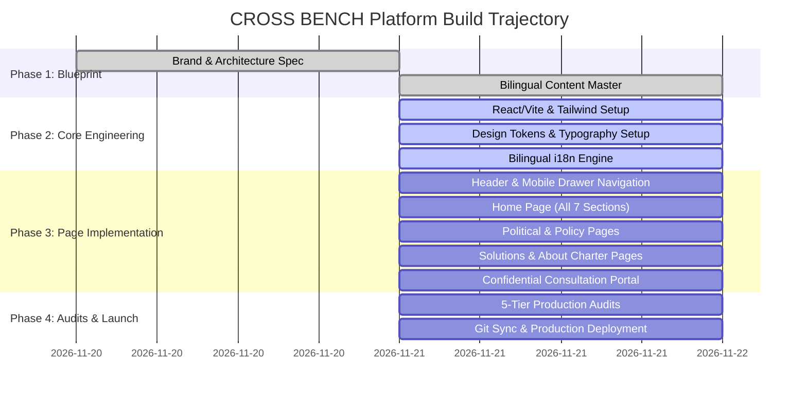

# 06. CROSS BENCH — Execution Roadmap & Sprint Checklist

> Step-by-step development, quality assurance, and deployment trajectory from foundational blueprint to production launch.

---

## Sprint Phasing

---

## Detailed Milestone Checklist

- [x] **Milestone 1: Strategic Foundations & GitHub Linkage**
  - [x] Analyze benchmark political consultancies (Varahe, I-PAC, Jarvis, Inclusive Minds).
  - [x] Formulate non-partisan Dual-Engine positioning for CROSS BENCH.
  - [x] Initialize local git workspace at `C:\Users\aa\.gemini\antigravity\scratch\CROSS_BENCH`.
  - [x] Connect with GitHub remote: `https://github.com/crossbench-india/CrossBench.git`.
  - [x] Author comprehensive 6-document architecture specification in `docs/`.

- [ ] **Milestone 2: High-Performance Frontend Implementation**
  - [ ] Initialize React + Vite project structure with custom Tailwind configuration.
  - [ ] Implement bilingual context provider (`en` <-> `hi`) with local persistence and zero CLS.
  - [ ] Build global layout: Acrylic blur header, responsive navigation, mobile bottom-sheet drawer, and corporate footer.
  - [ ] Implement all 7 views with rich, production-ready, authentic bilingual copy.
  - [ ] Build interactive 4-tier Client Solutions tabbed module.
  - [ ] Build encrypted intake and consultation booking portal with form validation and instant feedback.

- [ ] **Milestone 3: Audits & Quality Assurance**
  - [ ] Perform SEO & OpenGraph metadata audit.
  - [ ] Perform security and input sanitization audit.
  - [ ] Verify production build (`npm run build`).
  - [ ] Verify zero TypeScript / bundle warnings.

- [ ] **Milestone 4: Deployment & Remote Synchronization**
  - [ ] Commit all code and documentation.
  - [ ] Push to `main` on `https://github.com/crossbench-india/CrossBench.git`.
  - [ ] Deliver completion summary and walkthrough artifact.
